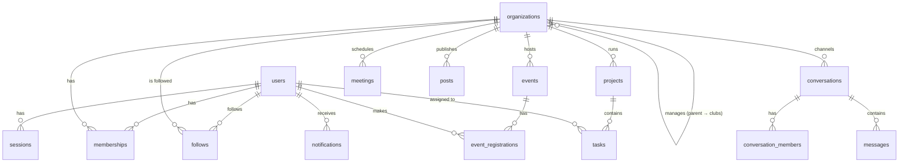

# Architecture

This document explains how Level Up is put together and why. It's written for students who will continue building the platform.

## 1. The big picture

```
Browser ──► Next.js server (one deployable app) ──► PostgreSQL
            ├─ Server Components: render pages, read data directly from the DB
            ├─ Server Actions:    handle every form/button (create, join, register…)
            └─ Route handlers:    chat polling, .ics and CSV downloads
```

- **No separate API server.** Pages are React Server Components that query the database through small, server-only `queries.ts` modules. The database is never exposed to the browser.
- **Mutations are Server Actions** (`features/*/actions.ts`). Each one:
  1. loads the signed-in user (`requireUser()`),
  2. validates input with Zod (`parseForm` in `lib/forms.ts`),
  3. **re-checks permissions on the server** (never trusts IDs sent by the browser),
  4. writes to the database, sends notifications, and calls `refreshAll()` so the UI re-renders with fresh data.
- **Forms keep working without JavaScript** where possible (plain `<form action>`). Forms with validation use the `useActionForm` hook, which keeps typed values when there's an error.

### Rendering mode

Every page depends on who is signed in and shows live data, so pages render per request. Next.js 16's optional *Cache Components* mode is switched off to keep the mental model simple. Public pages like `/events` could later opt into caching with `"use cache"` if traffic grows.

## 2. Feature modules

Code is grouped by feature (`src/features/<feature>`) rather than by file type, so everything about events (queries, actions, UI) lives together:

| Module | Responsibility |
| --- | --- |
| `auth` | Registration, login, sessions, profile and password settings |
| `organizations` | Organizations/clubs, membership, join requests, roles and responsibilities, follows |
| `events` | Events, registration with capacity and waitlist, check-in, exports |
| `projects` | Projects, tasks, kanban boards, progress |
| `meetings` | Team meetings and the calendar views |
| `chat` | Direct messages, group chats, organization channels |
| `feed` | Organization updates, activity feed, notification queries |
| `notifications` | `notify()` helper used by other modules |
| `shell` | Data for the sidebar (workspaces, unread counters) |

## 3. Data model



Key decisions:

- **One `organizations` table for both organizations and clubs** (`kind`). A club can have a `parentId` (e.g. *Coding Club* belongs to the *Student Union*). Every feature (events, projects, tasks, meetings, chat) works identically for both.
- **Memberships** carry a `role` (owner / admin / member) for permissions and a free-text `responsibility` ("Head of PR", "Treasurer") for describing who does what. `status = pending` represents a join request.
- **Registrations** are unique per (event, user). Cancelling keeps the row with `status = cancelled`. `updatedAt` doubles as the waitlist position.
- **Messages** use an increasing integer id, so clients can ask "everything after id 1234" cheaply.
- All timestamps are stored as `timestamptz` (UTC).

Schema: [`src/db/schema.ts`](../src/db/schema.ts). Migrations: [`drizzle/`](../drizzle). To change the schema, edit `schema.ts`, run `npm run db:generate`, review the SQL, then run `npm run db:migrate`.

## 4. Authentication

- Passwords are hashed with **scrypt** (Node's built-in `crypto`, random salt per password).
- A session is a random 32-byte token in an **httpOnly, SameSite=Lax cookie**. The database stores only its **SHA-256 hash**, so a leaked database can't be used to hijack sessions.
- Sessions live 30 days. Changing the password deletes all other sessions.
- Login runs a hash comparison even for unknown e-mails, so response time doesn't reveal which addresses have accounts. `?next=` redirects only accept local paths.
- `getCurrentUser()` is wrapped in React `cache()`, so it runs once per request no matter how many components ask.

## 5. Permissions

All rules live in one pure, unit-tested function: [`src/lib/permissions.ts`](../src/lib/permissions.ts).

| Who | Can |
| --- | --- |
| Anyone | Browse public events, clubs and public projects |
| Signed-in student | Register for events, join/follow clubs, message students, create clubs |
| Active member | Open the workspace, create and move tasks, schedule meetings, use team channels |
| Admin / owner | Edit the organization, manage events, projects and members, post updates |
| Owner | Everything above, plus assign owners and delete the organization (the last owner can't leave or be demoted) |
| Admin of a **parent** organization | Manage its clubs as if they were an admin |
| Platform admin | Manage any organization, mark organizations "official" |

## 6. Event registration and the waitlist

[`src/features/events/registration.ts`](../src/features/events/registration.ts)

1. Registration runs in a transaction that **locks the event row** (`SELECT … FOR UPDATE`), so two students can never take the last seat at the same time.
2. If seats remain, the student is `registered`; otherwise `waitlisted`.
3. When a registered student cancels, or an organizer increases capacity, the **oldest waitlisted** students are promoted and notified.

An integration test fires 10 simultaneous registrations at a 3-seat event and checks that exactly 3 get seats.

## 7. Real-time chat (and how to upgrade it)

Free serverless hosting (Vercel) doesn't keep WebSocket connections open, so the MVP uses **efficient polling**:

- An open chat calls `GET /api/conversations/:id/messages?after=<lastId>` every 3 seconds, **only while the tab is visible**, and receives only new messages.
- Sending is a Server Action with an **optimistic UI**: the message appears instantly and is confirmed by the server.
- Unread state is a `lastReadAt` timestamp per participant compared with the conversation's `lastMessageAt`.

To make it push-based later, replace the `poll` function in `features/chat/components/chat-room.tsx` with a subscription (Pusher, Ably or Supabase Realtime all have free tiers), and publish an event from `sendMessage`. Nothing else needs to change.

Organization channels mirror team membership: `features/chat/service.ts` adds and removes people whenever they join, are approved, are added, leave or are removed.

## 8. Time zones

The university's time zone (`NEXT_PUBLIC_UNIVERSITY_TIMEZONE`) is used for display and for interpreting `<input type="datetime-local">`. The server converts wall-clock times to UTC with `zonedTimeToUtc` (DST-safe, unit-tested), so times are correct no matter where the server runs.

## 9. Security checklist

- Server-side validation (Zod) and authorization on every action and route handler.
- Drizzle uses parameterised SQL. Search terms escape `%` and `_`.
- User-provided links are rendered only if they are `http(s)` (`safeUrl`), which blocks `javascript:` URLs.
- CSV exports neutralise spreadsheet formulas (`=`, `+`, `-`, `@`).
- Server Actions have built-in CSRF protection (origin checks). Cookies are httpOnly, `Secure` in production.
- Drafts, private projects, attendee exports, meetings and conversations return 404 to people without access.

**Before a real launch, add:** rate limiting on login and registration (for example Upstash's free tier), e-mail verification or SSO with the university, and password reset.

## 10. Scaling path

The MVP comfortably serves a single university. When it grows:

1. **Database:** add indexes as queries appear in slow logs. Neon and Supabase scale vertically with a click.
2. **Caching:** enable Next.js Cache Components for public pages (events, clubs, landing).
3. **Chat:** switch polling to a push service (section 7).
4. **Files:** move from image URLs to an upload service.
5. **Multiple universities:** add a `universities` table, reference it from `users` and `organizations`, and scope queries by it.
